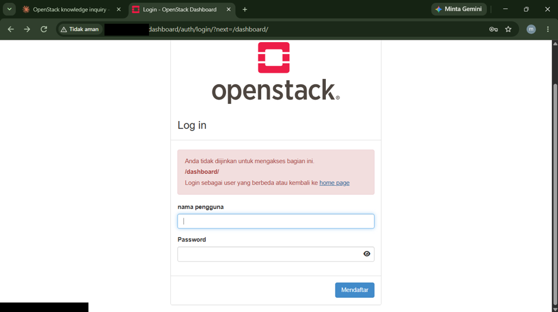
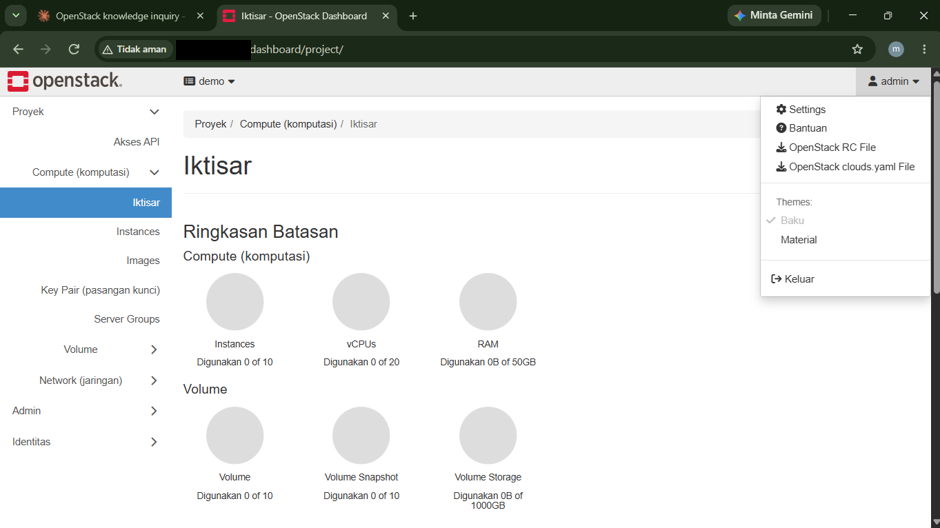
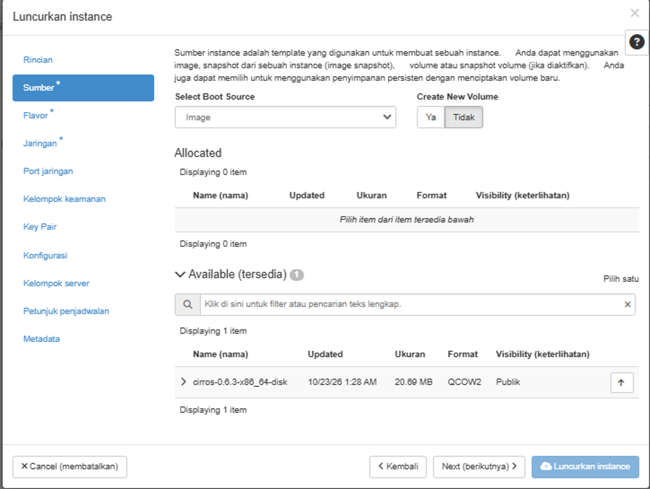
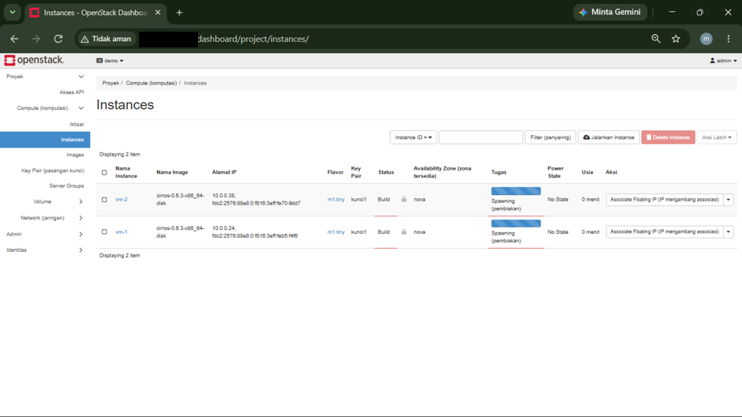
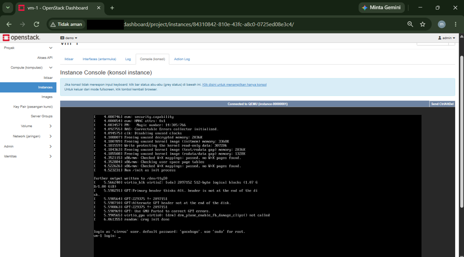
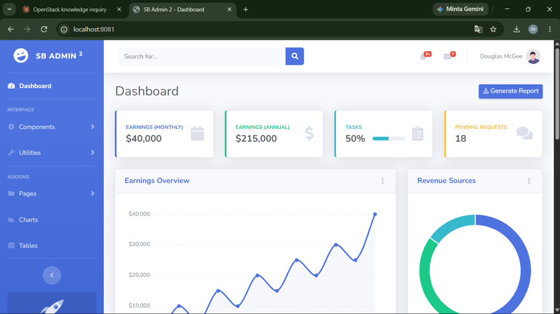

# ☁️ OpenStack DevStack — Membuat Instance Web


> Membangun cloud pribadi dengan OpenStack (DevStack) di VMware, lalu meluncurkan instance lewat dashboard Horizon.

**Author:** Markos Panjaitan
**Status:** 🚧 Dalam pengerjaan

Proyek ini bagian dari [jalur belajar System Administrator](https://github.com/markospanjaitan) saya.

---

## 📷 Screenshot

| Login Horizon | Ringkasan Proyek | Luncurkan Instance |
| :---: | :---: | :---: |
|  |  |  |

| Daftar Instance | Konsol vm-1 | Halaman Web |
| :---: | :---: | :---: |
|  |  |  |

---

## 🧩 Ringkasan

| Komponen | Keterangan |
| --- | --- |
| Platform | OpenStack lewat DevStack, dijalankan di VMware |
| Dashboard | Horizon (proyek `demo`) |
| Image | `ubuntu-24.04` dan `cirros-0.6.3-x86_64-disk` (QCOW2, 20,69 MB) |
| Flavor | `web.mini` (1 GB RAM, 5 GB disk, 1 vCPU) dan `m1.tiny` |
| Instance | `web-1` dan `web-2` (Ubuntu 24.04, flavor `web.mini`), serta `vm-1` dan `vm-2` (CirrOS, flavor `m1.tiny`) |
| Key pair | `kunci1` |
| Akses jarak jauh | Tailscale |

## 🛠️ Yang dikerjakan

1. Memasang OpenStack dengan DevStack di VMware.
2. Membuka dashboard Horizon dan memeriksa kuota proyek `demo` (10 instance, 20 vCPU, 50 GB RAM).
3. Meluncurkan `vm-1` dan `vm-2` dari image CirrOS dengan flavor `m1.tiny` dan key pair `kunci1`.
4. Memeriksa konsol `vm-1`: proses boot selesai dan prompt login muncul.
5. Mengelola instance lewat CLI: memeriksa daftar instance, jaringan, flavor, dan image, serta menyalakan instance yang berstatus SHUTOFF. Keempat instance berstatus ACTIVE ([hasil perintah](docs/hasil-perintah.md)).

> Tangkapan layar daftar instance di atas diambil saat `vm-1` dan `vm-2` masih berstatus *Build*. Status ACTIVE terbukti lewat CLI di [`docs/hasil-perintah.md`](docs/hasil-perintah.md).

## 📁 Struktur repo

```
.
├── README.md
├── images/                      # tangkapan layar Horizon
├── scripts/
│   ├── cek-openstack.sh         # daftar instance, jaringan, flavor, image
│   └── nyalakan-instance.sh     # menyalakan instance yang SHUTOFF
└── docs/
    ├── hasil-perintah.md        # hasil perintah openstack
    └── troubleshooting.md       # masalah dan perbaikannya
```

## 🐞 Masalah yang ditemui

| Masalah | Penyebab | Perbaikan |
| --- | --- | --- |
| Horizon tidak bisa dibuka (`ERR_CONNECTION_TIMED_OUT`) | IP VM berganti, sehingga alamat lama tidak lagi dipakai | Memakai IP Tailscale untuk semua layanan DevStack |
| `openstack` menampilkan `Missing value auth-url` | Kredensial belum dimuat di sesi terminal | `source /opt/stack/devstack/openrc admin demo` |
| Semua instance berstatus SHUTOFF | Instance mati setelah VM dihidupkan ulang | `openstack server start` ([skrip](scripts/nyalakan-instance.sh)) |

Detail ada di [`docs/troubleshooting.md`](docs/troubleshooting.md).

## 🔒 Catatan keamanan

- Password, token, dan file `local.conf` tidak diunggah ke repo ini.
- Alamat IP host pada tangkapan layar sudah disamarkan.
